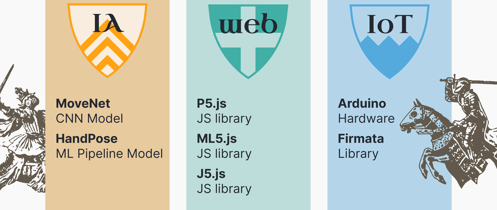

# MITID-bootcamp
Welcome to the README for the Intermediate Bootcamp designed for M.I.T.i.d students.
This page gathers all the essential information you may need in case you forget something.
Before we begin, here is an overview of the technical components and tools we will be using throughout these three days.



### 🙋🏻‍♂️ Remind me what a library is
>In programming, a library is **a collection of pre-written code that provides specific tools or functions you can use in your own projects**. Instead of writing everything from scratch, you can use a library to handle tasks such as drawing graphics, working with sound, or managing user interactions—saving time and allowing you to focus on creativity and design.

### How to use this repo
>[!CAUTION]
>For each new sketch you want to create, duplicate the `sketch` folder and rename your copy.

## Table of content
- [P5.js](#p5js)
    * [P5.js minimal setup](#p5js-minimal-setup)
- [J5.js (Johnny five)](#johnny-five)
  * [Firmata](#firmata)
  * [Create a circuit](#create-a-circuit)
  * [Add johnny five to your P5.js sketch](#add-j5js-in-your-p5js-sketch)
  * [Components documentation](#johnny-five-documentation-for-almost-each-components-from-your-kit)
- [ML5.js](#)
  * [Add bodyPose to your P5.js sketch](#bodypose)

## P5.js
p5.js is a JavaScript library designed to make coding accessible for artists, designers, educators, and beginners. It provides an easy and creative way to draw shapes, create animations, and build interactive visuals directly in a web browser. Built on top of standard JavaScript, **p5.js simplifies complex coding concepts and focuses on visual and interactive design**.

>[!TIP]
>Have a look at the [P5.js library documentation↗](https://p5js.org/reference/)

### P5.js minimal setup
First you need to load the library in the `<head>` of your `index.html` file. 
```html
    <!-- P5 lib -->
    <script src="<script src="https://cdn.jsdelivr.net/npm/p5@2.3.4/lib/p5.min.js"></script>"></script>
```
Then, in your `script.js` file, you can create the skeleton for your p5 sketch
```javascript

function setup(){
    // create a canvas
    createCanvas(600, 400);
}

function draw(){
    // place the code that should run repeatedly
    
    // change canvas background color for a light grey
    background("#F9F9F9");

    // draw a red circle
    fill("#FF0000");
    circle(100, 100, 50);
}
```


## johnny five
Johnny-Five (J5.js) is a JavaScript library used to program and control hardware components such as sensors, motors, LEDs, and microcontrollers like Arduino. It allows developers to interact with physical devices directly from JavaScript, making it easier to build interactive electronic projects without needing to write code in C++ (arduino language).

In simple terms, Johnny-Five acts as a bridge between code and hardware, enabling you to control the physical world — lights, buttons, and motion sensors — using familiar web development tools.

>[!TIP]
>You can have a look at the [J5.js library documentation↗](https://methio.github.io/p5.j5/).
Make sure to carefuly read the `Firmata` and `Add J5.js in your P5.js sketch` before reading the documentation.

Johnny-Five operates through two main components: hardware and software.

For the hardware setup, you will need to upload the Firmata firmware to your microcontroller (the red Arduino Uno). **This step only needs to be performed once**. After uploading Firmata, you can use your electronics kit to build and test various circuits. Firmata serves as a bridge, allowing you to control your Arduino board directly from a web page using JavaScript, and more specifically, the Johnny-Five library.

### Firmata 
Steps:
- [x] Plug in your Arduino via USB
- [ ] Open the Arduino IDE, select: `File > Examples > Firmata > StandardFirmataPlus`
- [ ] Select your board and port.
- [ ] Click the "Upload" button.

>[!CAUTION]
>Keep in mind:
> - You just need to upload firmata ONCE on your board.
> - Leave the board plugged to your computer when you want to use it. 
> - Make sure to unplug the board when you create or modify a circuit.

### Create a circuit
To create your electronic circuits, you will use your Arduino Uno (the red microcontroller). To understand how to connect the components properly, please refer to the [J5.js library documentation↗](https://methio.github.io/p5.j5/)

### Add J5.js in your P5.js sketch

Add the following line in your html head to load the library
```
<!-- load the p5.j5 library -->
<script src="https://cdn.jsdelivr.net/gh/methio/p5.j5@latest/j5.js" defer></script>
      
```
and then in your `script.js` file 
```
let board;
let led;                        // a variable for our LED

function setup() {
    createCanvas(400, 300);
    board = createBoard();
    createConnectButton(board);

    led = new five.Led(2);        // components can be created before connecting:
    led.blink(500);               // they will activate as soon as the board is ready
}

function draw() { 
    background(220); 
}
```
>[!TIP]
>🙋🏻‍♂️ More informations on leds can be found in the [documentation↗](https://methio.github.io/p5.j5/#led).

## ML5.js
ml5.js is a JavaScript library that makes machine learning accessible and easy to use directly in the browser. It is **built on top of TensorFlow.js** and provides a simple, beginner-friendly interface for tasks such as image recognition, text generation, pose detection, and more.

In the context of this bootcamp, we will focus on one model : BodyPose. [BodyPose documentation on ml5.js website↗](https://docs.ml5js.org/#/reference/bodypose)

### BodyPose

```javascript 

    let video;        // variable to store webcam
    let bodyPose;     // variable to store bodyPose model
    let poses = [];   // variable to store poses the model sends us

    // Load the model
    function preload() {
        bodyPose = ml5.bodyPose();
    }

    function setup() {
        // 🙋🏻‍♂️ We need to have a canvas
        createCanvas(640, 480);
        frameRate(12); // 👨🏻‍🚒🚒 in case computer starts burning
        
        // Create the video and hide it
        video = createCapture(VIDEO);
        video.size(640, 480);
        video.hide();

        // Start detecting poses with the webcam video as an input, output can be found in poses array
        bodyPose.detectStart(video, results=>poses=results);
    }

    function draw(){
        // display video in the canvas
        image(video, 0, 0, width, height);        

        // check if at least one person is detected
        if(poses.length>0){

            // console.log what the model detects
            console.log(poses);
        }
    }
```


[Bring me back to top 🚀](#table-of-content)